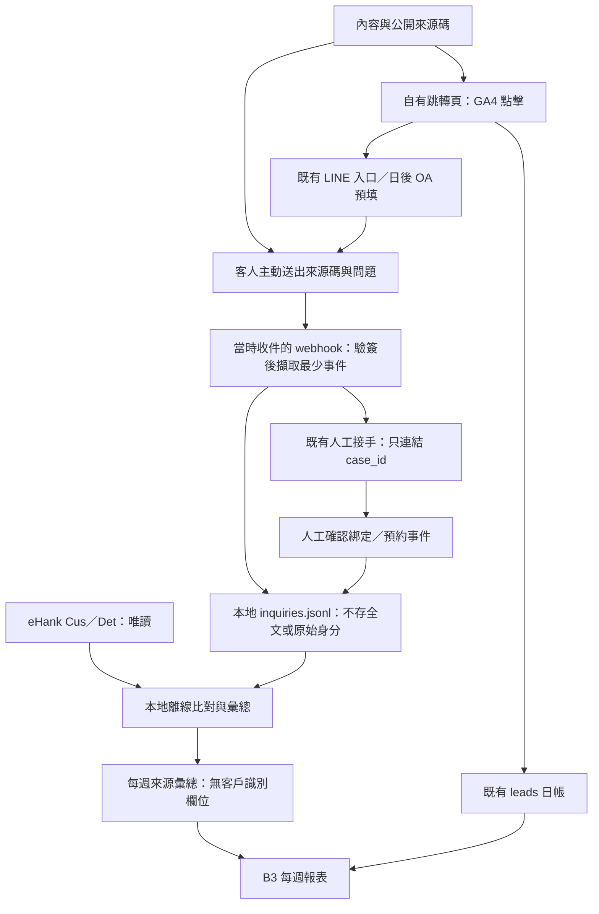

# B2 設計：內容來源 → LINE 詢問 → 預約 → POS 收件

日期：2026-10-30。狀態：**設計完成、未實作、未部署、未量測轉換**。對應任務卡：`docs-internal/cards/B2-source-to-order-design.md:1`；查閱與驗證紀錄見 [B2-RESULT.md](cards/B2-RESULT.md)。

**建議先做「每篇內容一個來源碼＋客人主動送出來源碼＋店機本地事件帳＋唯讀收件比對」，沿用既有 GA4 點擊統計。** 不先導入 LIFF，也不把加好友網址上的任意 query 當作已進入 webhook。報表只宣稱「依明定規則找到收件關聯」，不宣稱已證明內容造成交易、收到款項或增加營收。

## 1. 開工契約與現況證據

| 項目 | 本卡界線 |
|---|---|
| Outcome | 提供可交給 B3 與後續實作者的來源、詢問、預約、收件對照規格，包含未知與去重規則。 |
| Owner／Maker／Checker | 店主決定營運口徑；Claude commander 負責整合驗收；Codex 產出與交付前自檢。本輪沒有另派獨立審查席。 |
| 可寫成果 | 僅新增本文件與 `docs-internal/cards/B2-RESULT.md`。 |
| Authority | 本輪僅文件設計。後文檔名、欄位、行數、部署項目均為提案，不是已執行的變更。 |
| 驗收證據 | 當前原碼行號、限定範圍內資料結構、LINE 官方文件、合成案例推演、交付檔案與 Git 差異檢查。 |
| 不做 | 不改程式、不連店機、不呼叫營運 API、不發訊息、不改 POS、不新增追蹤服務、不 commit。 |

查閱基線：分支 `integration/20261030`，HEAD `2b7671dcbe4e9267de2c3d910ea2e583b6cb77af`；開工時工作樹乾淨。程式讀本工作樹；真實營運資料只讀 `C:/Users/cyc39/Documents/New project 5/data/`，只取結構與彙總，不收錄客戶實值。

| 已觀察事實 | 證據與設計影響 |
|---|---|
| 社群 caption 目前共用 `source=post`。`CaptionTracking` 有 source／campaign，但 `withLineContact` 只使用 siteBaseUrl。 | `src/contentPlan.ts:1603`、`:1636`、`:1656`。目前不能由這個連結分辨單篇或 FB／IG。 |
| 站內服務／文章觸點已有各自 slug。跳轉頁送出 GA4 source／link_source 後，前往固定的 lineUrl。 | `src/generatePublicSite.ts:3432`、`:3444`、`:3514`、`:3557`；產物 `docs/go/line.html:22`、`:49`。網站 query 不會由現有程式附到 LINE 訊息。 |
| leads 是 `{month, days:{日期:日帳}}`；日帳有點擊、搜尋事件與量測狀態。 | `src/ga4Report.ts:231`、`:239`、`:247`、`:257`；實際讀取 `data/leads/2026-10.json` 結構。既有 unknown／total_only 語義必須保留。 |
| 限定真實資料目錄中的 ga4-exports 只有 README，沒有 CSV；conversions 沒有檔案。 | 2026-10-30 目錄盤點。不能假設已有逐來源轉換資料。leads 中部分來源已有較細 slug，不代表它們已串到 LINE 使用者。 |
| 綁定格式為以原始 userId 作鍵，值包含 customer_id、phone、name、updated_at；每次查詢可覆寫。 | `shop-pc/fxwash/runtime/webhook_server.py:134`、`:144`、`:643`、`:655`。updated_at 不是首次綁定時間；查到電話／客號不是身分核實。 |
| 一支電話可能得到多個客號，回傳以斜線串接的 customer_id。 | `shop-pc/fxwash/runtime/lookup_service.py:78`、`:97`。不能把複合字串當單一 Cid，也不能任意挑第一位。 |
| 店機快照先回 200，再解析事件；以記憶體 replyToken 去重。圖片先走圖片分支；選時間 postback 只產生回覆。 | `shop-pc/fxwash/runtime/webhook_server.py:575`、`:602`、`:610`、`:627`。目前沒有足以保證完整詢問日帳、跨重啟去重或預約成立的證據。 |
| 舊 bot 有 append-only staff inbox、handoff 與 status；其 push_inbox 預設會通知。店機快照末路由則交給聊天函式。 | `line-bot/staff_notify.py:19`、`:89`、`:220`、`:257`、`:705`；`shop-pc/fxwash/runtime/webhook_server.py:781`；`docs-internal/SHOP-FACTS.md:112`。不能直接匯入舊通知模組到店機，也不能把兩邊當成已接通。 |
| POS 連接器讀 Cus 與 Det，映射 Did→piece_id、Dno→order_no、Indate→received_at。 | `shop-pc/fxwash/connectors/base.py:240`、`:291`、`:320`。Dno 的映射名稱不證明它就是一張交易單；本方案以收件明細計數。 |
| MDB wrapper 只接受 SELECT 並用 Mode=Read；既有讀法會把欄位轉成字串。 | `shop-pc/fxwash/bridge/ai_engine/db_manager.py:36`、`:43`、`:59`。本輪只讀程式，沒有實際開啟 MDB。日期精度與格式仍待樣本驗收。 |
| B3 已存在，但 conversions 目前只列入檔案盤點。 | `scripts/weekly-report.py:130`、`:404`、`:504`。放入新 JSON 並不會自動得到來源→收件表，仍需後續 reader。 |

## 2. 來源如何進 LINE

### 2.1 可行方案比較

官方文件查閱日為 2026-10-30；本輪未登入 OA Manager、未開實際店家連結、未發測試訊息。

| 方案 | 官方能支持的行為 | 可以取得什麼／限制 | 本案選擇 |
|---|---|---|---|
| 加好友／官方帳號介紹頁連結加 `?source=...` | 官方記載 `https://line.me/R/ti/p/{編碼後 OA ID}` 開帳號頁，已是好友時可開聊天。 | 官方沒有記載任意 query 會保留並透傳給 follow／message webhook。不能據此建立 source→userId 關係；也不斷言所有客戶端一定刪除 query。[URL scheme 官方說明](https://developers.line.biz/en/docs/messaging-api/using-line-url-scheme/#sharing-line-official-account) | 保留作入口；不當身分或來源橋梁。 |
| **每篇一個公開來源碼，客人手動傳送** | 客人實際送出文字後產生 message event。 | 只需 caption 顯示來源碼、webhook 解析。少打、改字、分享轉傳、只加好友不說話都會失去歸因；來源碼是自述證據，可被複製。[Webhook 接收說明](https://developers.line.biz/en/docs/messaging-api/receiving-messages/) | **第一階段推薦**；實際送達才算詢問。 |
| OA 聊天預填文字 `https://line.me/R/oaMessage/{編碼後 OA ID}/?{編碼後整段文字}` | 官方支持開指定 OA 聊天並預填輸入框；ID 與整段文字用 UTF-8 percent encoding。 | 不是 `?text=...` 的任意鍵值語法；客人仍須按送出。手機與社群內建瀏覽器須驗收；不能假設 PC 原生 LINE 支持同樣行為。[OA 聊天與平台限制](https://developers.line.biz/en/docs/messaging-api/using-line-url-scheme/#opening-a-chat-screen-with-a-line-official-account) | 確認真正 OA ID 後的增強方案；沿用同一來源碼與手動備援。 |
| LIFF URL 帶來源，例如 `https://liff.line.me/{liffId}/?source=SXJ-261030-S1` | 附加路徑／query 先放入 `liff.state`，SDK 初始化後組成第二次跳轉 URL。 | 可在 LIFF 頁取得來源；不會因此自動產生一則 OA 詢問。需建立 LIFF、端點、授權與可靠身分對照，維護成本較高。[LIFF 開啟流程](https://developers.line.biz/en/docs/liff/opening-liff-app/) | 暫不採用，留待人工輸碼流失量足以支持投資時評估。 |

LIFF 若日後上線，必須依官方做伺服器端 token 驗證，不能信任前端提交的 userId；LIFF 所在 LINE Login 與 Messaging API channel 需核對 provider，跨 provider 的 userId 不同。這仍不等於已驗證其 POS 客號。[LIFF 使用者資料](https://developers.line.biz/en/docs/liff/using-user-profile/)、[userId 範圍](https://developers.line.biz/en/docs/messaging-api/getting-user-ids/)

**入口身分仍有未知：** 當前跳轉目標是既有 `line.me/ti/p/…` 連結；店務資料另有一般 LINE ID／電話用語。本輪沒有證明它就是可用於 oaMessage 的 OA Basic ID 或 Premium ID。不得把電話號碼、邀請 token 或整條加好友網址直接代入 `{OA ID}`。第一階段維持既有目的地與明碼提示；預填功能須待 OA Manager 與手機驗收，不能由本設計宣稱已可用。參考 `docs-internal/SHOP-FACTS.md:21` 與上述官方 ID 規格。

### 2.2 來源碼與點擊沿用方式

- 提案格式：`SXJ-261030-S1`，表示某日某內容槽位；專題可用 `SXJ-261030-F01`。皆為合成示例，不是已發布活動。ASCII 大寫、數字與連字號，長度上限 40，完整 token 精確比對。
- 同一內容重試發布沿用代碼；不同內容不重用舊碼。以 source registry 固定 code→content_id、日期／slot 或 feature slug、公開連結與 placements。不要從貼文 ID 反算客人來源。
- caption 顯示「LINE 詢問時，請傳『SXJ-261030-S1』加上你的問題」。連結使用既有自有站 `/go/line.html?source=SXJ-261030-S1`；既有 GA4 的 source／link_source 維度即可沿用，不加 userId、電話、Cid 或訊息全文。
- 第一階段以內容為歸因粒度；同內容跨 FB／IG／YT／TikTok 使用同碼，可維持同份影片文案。registry 可記多個 placements，但無額外證據時不能拆出詢問來自哪個平台。
- 站內既有 slug 可加入 registry 的別名，只有在客人實際傳送對應碼時才可接上詢問。舊 `post`、`footer` 等點擊彙總保留原類別，不事後分攤到單篇。
- 未帶碼記 `unknown_no_code`；格式合法但未登錄記 `unknown_unregistered_code`；單則帶多個不同有效碼記 `unknown_multiple_codes`，交人工更正，不猜測。只保存上述原因，不保存客人打錯的任意文字。
- 只有有效來源 token 才可從交給既有查件／聊天路由的文字移除，讓「代碼＋查件」仍能進原路由。剝除來源碼不得改變問題其餘內容或新增回覆。

## 3. 資料流程與存放位置

GA4 點擊與 LINE 問話之間沒有已知個人 join key；圖中是使用者行動流程，不是宣稱瀏覽器 cookie 已與 LINE 身分串接。客人也可看完貼文直接搜尋 LINE，完全沒有可計數的網站點擊。

| 檔案／資料 | 寫入者與位置（均為後續提案） | 內容與邊界 |
|---|---|---|
| `data/attribution/source-codes.json` | 內容端維護；核定版本提供 runtime 只讀副本 | 只放公開內容碼、metadata 與版本，不放客人資料。 |
| 店機 `<shop.root>/data/inquiries.jsonl` | 當時收件 runtime 單一 append writer | 訊息 metadata、綁定與預約事件；不與社群 repo 的 data 混用。 |
| 夜間備援自己的 `data/inquiries.jsonl` | 若該流程實際啟用，沿用相同 schema／hash 範圍，寫自己的檔案 | 本卡沒有接通或同步兩台機器。未納入夜間事件時 coverage 必須標缺口。不能兩台同寫網路共享 JSONL。 |
| 既有 `customer_bindings.json` | 留在既有營運環境 | 不複製到 repo／報表；只在本地比對，原格式仍承擔既有查件用途。 |
| `data/conversions/source-to-order-<ISO週>.json` | 本地離線彙總器輸出後，以另行核准的管道提供 B3 | 僅逐來源計數、狀態、時間與完整性；不含 user hash、Cid hash、事件 ID 或個人明細。 |
| `data/leads/<yyyy-MM>.json` | 原有 GA4 collector | 繼續只作點擊／搜尋漏斗；本方案不把詢問寫成 line_click。 |

不同店／OA／POS 資料來源必須有穩定 `shop_id`、`oa_scope`、`pos_source_id`。日夜 runtime 若服務同 OA 與 POS，使用相同邏輯 scope、不同 `runtime_id`；若 scope／金鑰未對齊，B3 不合併成完整數字。

## 4. 詢問與事件欄位

### 4.1 最少事件帳

建議 `inquiries.jsonl` 是**事件帳**，不是「一行就等於一個詢問」。每則合格訊息寫一個 `message_observed`，由離線 reader 聚合；綁定、預約、更正使用新事件。這樣才可處理重送、先到後到與首句更正。

| 欄位 | 型別／必填 | 定義 |
|---|---|---|
| schema_version／policy_version | 字串／必填 | 例如 v1；欄位與口徑分別版本化。 |
| event_kind | 列舉／必填 | message_observed、binding_observed、binding_confirmed、binding_revoked、booking_requested、booking_confirmed、booking_cancelled、handoff_linked、source_corrected、unsend_tombstone。 |
| event_id | 字串／必填 | LINE 事件用 `oa_scope + webhookEventId`；人工事件用本地唯一 ID。禁止以 replyToken 作持久去重鍵。 |
| ts／recorded_at | 帶時區時間／必填 | ts 取 LINE timestamp（事件發生時間），recorded_at 是本地收到／落帳時間；人工事件另記生效與記錄時間。 |
| shop_id／oa_scope／runtime_id | 字串／必填 | 店別、邏輯 OA、實際收件 runtime；不放憑證。 |
| user_key／hash_key_version | 字串／訊息必填 | HMAC-SHA-256（本地秘密、shop_id、oa_scope、原始 userId）；全長輸出，非原始 userId。缺 userId 不建立可歸因詢問。 |
| message_key | 字串／訊息必填 | 本地 HMAC 後的 message.id，用於收回訊息對照；不保存訊息正文或媒體。 |
| message_type／first_intent／intent_basis | 列舉／訊息必填 | text／image 等；估價／查件／收送／其他；分類依路由規則或明確上下文，不新增模型呼叫。 |
| source_code／source_method／source_status | 字串／訊息必填 | 有效碼或 null；keyword／oa_prefill／manual_correction／unknown；預填來源若無法分辨就統一 keyword，不猜測客戶端。 |
| source_registry_version | 字串／訊息必填 | 當時採用的來源碼清單版本，避免日後改表回溯捏造舊歸因。 |
| inquiry_id | 字串／聚合後必填 | 依 shop、OA、user_key、台北日期產生穩定本地 ID；runtime 不影響同案 ID。 |
| staff_case_id | 字串或 null | 只存既有接手案件的本地關聯；不當作 POS 客號。 |
| cid_key／pos_source_id | 字串／綁定事件必填 | 單一且可核對 Cus 的 Cid 在本地正規化後 HMAC；不輸出原始 Cid。 |
| binding_trust／binding_version | 列舉／綁定事件必填 | observed、confirmed、revoked；每次換客號另開版本，保留歷史，不能覆寫舊案。 |
| actor_kind／evidence_ref | 列舉、受限本地參照／人工事件必填 | staff 等角色與本地證據索引；不放姓名、電話、任意備註、對話或照片路徑。 |
| booking_id／booking_status | 字串、列舉／預約事件必填 | requested、confirmed、cancelled；由店員確認服務與可行安排，非 bot 自行承諾。 |

HMAC 金鑰是後續本地設定，不在本輪產生或讀取；不進 Git／GA4／Vault／報表。Cid 低熵，不能以裸 SHA-256 保護。身分 hash 仍是可連結資料，不宣稱匿名；金鑰版本不一致時不硬接資料。日夜金鑰共享／輪替的保管方式需另行落實。

不在本帳存 raw userId、姓名、電話、地址、LINE 文字、照片、base64、token、付款或金額。隱私依 `docs-internal/SHOP-FACTS.md:114`：照片七天規則不等於本地已有清除驗收，也不推定所有 metadata 一律七天。提案本地事件保留 90 天、只留非識別彙總較久；這是待店主核定的新期限，未核定前不啟用採集。append-only 指正常事件追加；收回／刪除請求仍須透過 tombstone 排除使用，並有受控清除與備份到期方式，不能以 append-only 拒絕刪除。

### 4.2 詢問數的明確口徑

1. **一個詢問＝同一 shop＋OA＋LINE 使用者，在台北同一曆日的第一則合格來訊。** 同日重問、傳五張圖或同事件重送，仍只算一個詢問；隔日再次來訊可另算。因此這是「詢問客日」，不是唯一客人數、整段對話數或新增客戶數。
2. 只取一對一、驗簽通過、具 userId 的客人 message。文字／圖片／語音等可入帳；只有貼圖、follow／解除封鎖、測試 webhook、群組訊息、bot 回覆不算詢問。無法判斷的業務意圖記其他。
3. 原始時間依 ts 排序，同時以 event_id 穩定排序；聚合後最早合格訊息決定 first_intent。圖片僅在明確估價上下文時歸估價，其餘歸其他；電話／客號查詢歸查件，收送安排歸收送，混合而無主路由者歸其他並保留規則版本。
4. 每個客日採**第一個明確有效碼**作來源；後續不同碼記衝突，不覆蓋。先無碼、同日後來才帶碼，可補出來源，但 `source_effective_at` 必須是實際帶碼時間；先前已發生的收件不可因此拿走歸因。
5. 同客日帶多個來源或人工更正，用 source_corrected 事件附原因代碼與證據；B3 產生新版彙總，保留版本關係。不得拿 referrer／GA4 同分鐘點擊猜配某位客人。
6. 第一則查件仍計入詢問並保留查件分類。它可能是舊客服務，不把全部詢問標成新商機；可另列 acquisition_inquiries（估價＋收送）供觀察，但不能混用分母。

去重依官方 webhookEventId；官方指出重送可能改變到達順序，timestamp 仍為原事件時間。[Webhook event 共用欄位](https://developers.line.biz/en/reference/messaging-api/#common-properties)、[重送注意事項](https://developers.line.biz/en/docs/messaging-api/receiving-messages/#redeliver-a-webhook-that-failed-to-be-received)

本地 journal 以單 writer、鎖與完整 UTF-8 JSON 行追加；重啟可重播建立 event_id 索引，重送不再加算。末行截斷或中間毀損必須報 coverage 缺口，不能靜默略過後說完整。鑑於現況先 200 後落帳，後續實作應把「少量 metadata 持久追加」放在驗簽後、200 前；POS 查詢與彙總一律離線。寫入失敗時保持既有客服可用，但必須留下錯誤與未量測時間區間，不得宣稱 200 代表事件已保存。沒有可靠故障區間／重送補齊證據，就不能報完整 0。

### 4.3 接既有 staff handoff 與預約

- 在既有建立／接手案件的 payload 加 inquiry_id、source_code、source_status，保留原 case_id。既有 HANDOFF_PENDING／HUMAN_ACTIVE／BOT_ACTIVE 的控制權與回覆流程由原系統負責，統計不切換狀態。
- 將已發生的 handoff 追加成 handoff_linked；不要為了記帳呼叫預設 `notify=True` 的 push_inbox，也不要觸發 push_group、push_user、notify_guest 或入庫 monitor。`saved`、`group_notified`、`status=done` 都不是預約或訂單成立證據。
- 店機快照未證明已接通舊 staff inbox；第一階段可先記 inquiry，staff_case_id 為 null。若沒有受控人工記錄入口，預約／confirmed 綁定顯示未知，不宣稱全鏈完成。
- datetime picker、客人說想收送或填齊資料，只記 booking_requested。店員實際確認安排後才能記 booking_confirmed；改期／取消另追加，不修改舊行。到店一般送洗無須預約，不能要求每筆收件一定有預約，參考 `docs-internal/SHOP-FACTS.md:60`。
- B3 可另列「確認預約數／取消數」，不塞進三欄收件指標。預約未確認、人工未留痕均是未知，不能用一則「已為您記下」的 bot 回覆補成 confirmed。

## 5. 詢問到 POS 收件：演算法與邊界

### 5.1 先拆開卡片中的兩種七天

任務卡第 3 題寫「詢問後七天」，第 4 題寫「綁定後七日」。兩者在晚綁定時結果不同，不能共用一個未註明起點的 conversion_count。

| 指標／用途 | 起點與終點（左含右不含） | 共同條件 |
|---|---|---|
| **I7：inquiry_7d_received_inquiries**；回答第 3 題 | `t_i ≤ 收件時間 < t_i＋168 小時`。 | 來源與有效核實綁定必須在該收件前已成立，依下述分配規則。 |
| **B7：bound_7d_received_inquiries**；B3 三欄的第 3 欄，回答第 4 題 | 本次詢問已有有效核實綁定：t_b＝t_i；否則 t_b＝本次詢問後第一次核實綁定時間。`t_b ≤ 收件時間 < t_b＋168 小時`。 | 新核實綁定須在 `[t_i, t_i＋168 小時)` 內進入本次漏斗；逾期另列 late_binding。 |

「詢問時已綁定」是 B7 的明示 cohort 規則，**不是重寫歷史首次綁定時間**。原 binding_confirmed_at 保留，t_b 名稱為 binding_cohort_start。未綁定者是未知；直到後續證據補齊前，不是已觀察到 0。

I7 最晚在詢問後七天成熟；B7 因允許七天內才綁定，最晚在詢問後十四天成熟。每週一看上週詢問時，必須出「暫計／待滿窗」，不能把仍在追蹤的詢問當失敗。

### 5.2 本地離線比對步驟

1. **凍結輸入。** 記錄產報 as_of、schema／policy／registry 版本、店／OA／POS 身分、資料可觀察起迄與缺口。事件只取 recorded_at 不晚於 as_of 的版本，重送以 event_id 去重，按 ts 聚合客日。時區統一 Asia/Taipei，內部時間可保存 UTC。
2. **形成身分歷程。** 從新帳 binding_observed／confirmed／revoked 還原 user_key↔單一 cid_key 的生效區間。現有 customer_bindings 只可匯入為「當下 observed 基線」；updated_at 不補成 first_bound_at。query-only 預設 observed；可計算候選關聯，但不列入已核實主數字。店員在既有接待時確認對照，才提升 confirmed，不新增驗證推播或自動綁定修復。
3. **正規化 Cid。** 用 Cus 的實際單一識別字串為基準，保留前導零，不把 Cid 強轉整數；只有店機樣本證明無碰撞時才可加別名。斜線複合客號、同手機多客、Cid 不存在、Cid 與 State 衝突，一律 identity_ambiguous。不要照 connector 的 fallback 默默把 State 當客號。
4. **取收件事實。** 後續由店機離線 exporter 沿用唯讀連線，只讀所需 `Cus.Cid` 與 `Det.Did/Dno/Cid/Indate`；State 僅作異常診斷，不作未核實替代鍵。每列代表一筆收件明細；Did 作候選去重主鍵，需先驗證非空與唯一。跨來源以 pos_source_id 分隔；同 Did 值互相矛盾時標 POS 資料衝突，不自動合併。
5. **解析收件時間。** 先驗證 Indate 是日期還是含時間、民國／西元與 locale；不能直接字串排序，也不能把 Timei 當收件時間。若只有日期，視為該台北日的時間區間：整個區間確定落在窗口且晚於來源／綁定生效才可算；與起點、終點或綁定同日相交但先後不明，標 date_boundary_unknown。不可用當日 00:00 假裝精確時間。
6. **建立候選。** 每個收件明細對照相同 cid_key 的詢問；必須落在所選 I7 或 B7 窗、來源碼已生效、confirmed 綁定已生效且未撤銷。既有無碼詢問也參加分配，來源桶為 unknown，避免有碼案件搶走更晚的未知來源詢問。
7. **只分配一次。** 同一使用者多個客日均符合時，採「收件前最近一個符合條件的詢問」；精確同時以 inquiry_id 穩定排序。每筆明細在每種政策內最多歸一案。不同 LINE 使用者共用同 Cid 而無明確主要對照，標 shared_cid_conflict，不任選；未核實的更晚相關詢問若會影響唯一分配，也標衝突，不偷歸較早的有碼案。
8. **聚合。** 每來源 `收到至少一筆已分配收件的 distinct inquiry_id` 為轉換詢問數；多件衣物不把一案加成多次。另可列 matched_received_pieces（去重明細數）。I7、B7 各自分配，兩者是平行觀察，不能相加當總訂單。
9. **輸出狀態。** 無身分、observed-only、衝突、日期邊界、未滿窗、採集／POS 缺口各帶 reason。不符「有收件」的窗口已滿、身分可判且全窗資料完整，才可標 no_receipt_observed。它表示該範圍未觀察到收件，不保證客人沒有用其他身分到店。

**Det 完整性是必要限制：** 快照只查 Det，沒有證明取件後還保留全部明細、刪單／作廢如何表示，也沒有證明 Did 的資料庫唯一約束。單次期末查不到一列，不能據此說七天內沒收過。後續可在授權唯讀下定期擷取去識別收件事實，建立有起訖與缺口的本地快照帳；但若件在兩次快照間進出，仍可能漏失。若須讀歷史表（如 Deh），先驗表與去重語義，不在本卡推定其存在或沿用歷史記憶。未解決前只能報「Det 當次可見之關聯下限」或未知，不能報完整轉換率。

**不是金流或訂單張數：** Cid＋Indate 只提供客號與收件日期關聯。Dno 映射成 order_no 並不足以證明交易單號。此方案不加總 Price、不推算付款或營收，也不把客號＋日期的群組稱為正式訂單。

### 5.3 必須保留的邊界結果

| 情況（皆為規則或合成案例） | 處理 |
|---|---|
| 同一事件重送、不同 runtime 重複收件、重啟重播 | 同 oa_scope＋webhookEventId 只算一次；若 runtime 來源 scope 無法核對，標 coverage 不完整。 |
| 同人同日多次詢問 | 一個詢問客日；隔日新案。一次收件在各政策內只分配給最近可判詢問，不同來源不重複搶單。 |
| 先有收件，兩天後才首次綁定 | 不進 B7，也不偷偷回填 I7 的已核實主數字；可另列 pre_binding_receipt_candidate，需人工回溯證據。早於詢問的收件永遠不歸該詢問。 |
| 詢問第 2 天核實綁定，第 8 天收件 | I7 不算；B7 若其他證據完整可算。證明兩個七天指標不能混名。 |
| 詢問前已有有效核實綁定，第 3 天收件 | t_b＝本次詢問時間；I7／B7 各可命中一次。不能以「綁定是幾個月前」錯誤排除舊客。 |
| 第 9 天才首次核實綁定 | 本次 cohort 記 late_binding；不無限延長舊內容的轉換窗口。新的詢問另開新 cohort。 |
| 改綁不同 Cid／同手機多客號／多人綁同 Cid | 依版本與生效區間；無可靠唯一對照則未知。不能讓今天的新綁定重算昨天所有訂單。 |
| 來源碼在收件後才補上 | 該收件只留作未知來源收件診斷，不計入補碼後有碼案件的收件數；該案標 source_after_receipt，不能直接當未收件。人工有獨立證據時走明示更正版本。 |
| 收件時間恰等於起點／恰等於七天終點 | 精確時間在起點可納入，終點排除；只有日期而無法確認先後時記邊界未知。 |
| 已取件、資料移表、POS 備份過舊、當日離線 | 缺口不能當 0；可列有證據的下限，完整率／未成交結論仍未知。 |
| 預約確認後取消／直接到店未預約 | 取消從有效預約數扣除但保留歷史；到店收件可獨立成立，不以預約作必經閘。 |
| 貼文被轉傳、客人修改預填文字、來源碼被猜中 | 只代表帶該碼詢問的關聯；無法證明原始曝光、個人點擊或因果增量。 |

## 6. B3 三欄、週別與輸入契約

### 6.1 店主看的三欄

| 來源碼／內容 | 詢問數（詢問客日） | 綁定後七日有收件的詢問數 B7 |
|---|---|---|
| `<來源碼>` | `<本週 cohort 詢問數>` 或未知／部分 | `<已核實關聯數>；待滿窗 n、未知 m`；資料不足時顯示未知原因 |
| unknown | 同規則 | 不把未知來源的詢問或收件分攤給其他碼 |

這是格式示意，不是私享家實測數字。另以一行附「I7 詢問後七日有收件 x；確認預約 y；可對照／未知／待滿窗各幾案」；沒記錄預約則寫未知。收件數用詞保持「有收件的詢問數」，不縮寫成「訂單」或「成交」。

- 週別：ISO 週、Asia/Taipei、週一 00:00 至下週一 00:00。cohort 按詢問的 t_i 歸週；該案跨週才收件仍回到詢問週。若另做本週 POS 收件表，必須獨立，不能和 cohort 表相加。
- B3 每週一產上週的暫計與已成熟舊週的修訂版。B7 最長追到詢問後十四天，加上已知資料延遲；沒有明確 watermark 就保持未完成，不憑等待天數自動視為資料完整。
- I7／B7 的去重政策與 pending 分母固定版本。先算候選分配再切詢問週，不能只讀本週詢問而讓跨週重複領同一收件。
- 主數字使用 confirmed 對照；observed-only 的候選數另記，不混入。0 僅用於資料／身分／窗口都可判的子集合；總數有未知時必須顯示未知或「至少 n」，不得把 n 說成完整總數。
- 比率若要呈現，分母僅能是同政策「已滿窗且可判定」詢問，並同時列可判定覆蓋率；不能拿已知少數案當全部詢問的轉換率。B3 第一版建議只報數量與狀態。
- LINE 點擊按既有 source_clicks 的 measured 日帳另列；與本表不是同一個人級 cohort。不能將 line_click、click_line_cta 相加為獨立人次，也不能以詢問數÷點擊數冒充真實個人轉換率。只看內容的人可能沒有點擊、也可能同人多次點擊。

### 6.2 交給 weekly-report.py 的新增輸入

B3 **只讀彙總**，不必取得客戶明細或連店機。下列檔案與欄位現在尚未建立。

| 輸入 | 必要欄位 | B3 的讀法 |
|---|---|---|
| `data/attribution/source-codes.json` | schema_version、registry_version、entries；每項 source_code、content_id、kind、日期／slot 或 feature_slug、placements、valid_from、retired_at | 顯示來源名稱與公開內容參照；retired 只停新內容重用，不抹掉歷史。來源改名不合併計數。 |
| `data/conversions/source-to-order-<ISO週>.json` | schema_version、policy_version、registry_version、cohort_week、timezone、as_of、revision、supersedes、shop_id、oa_scope、pos_source_id、status、coverage、rows | 按 week 與版本驗證後，選 as_of 不晚於產報時間的最新有效 revision；不把多次匯出相加。 |
| 彙總 rows 每項 | source_code（或 unknown）、inquiries、unique_line_users、first_intent_counts、booking_confirmed、booking_cancelled、I7、B7 | 詢問客日與不重複使用者分開。只有合格來源碼可作表格 label，避免任意文字進報表。 |
| I7／B7 每項 | received_inquiries、matched_received_pieces、candidate_only、pending_window、unknown_inquiries、matured_no_receipt、status、reason_counts | 以互斥案件狀態統計；不得將同一未知原因重複加成人數。candidate_only 是未知的診斷子集，不另外加到案件總數。 |
| coverage | inquiries_from／through、bindings_from／through、pos_from／through、runtime_ids、gap_intervals、identity_status、pos_completeness、date_precision、exported_at | 缺檔、空檔無覆蓋聲明、壞行、範圍不足或版本不相容時，顯示未知；不能自動補零。 |

`received_inquiries＋pending_window＋unknown_inquiries＋matured_no_receipt＝該來源 inquiries`，各政策分別成立；已確定命中者不再列 pending。reason_counts 可一案多原因，但不能拿原因總和充當 unknown_inquiries。每案只取一個主狀態，優先序：身分、來源生效或唯一分配無法判斷→unknown；否則有有效命中→received；否則有採集／POS 缺口→unknown；否則未滿窗→pending；否則→matured_no_receipt。POS 只缺其他可能明細但不影響某案既有命中的真實性與唯一分配時，可以保留該命中，整體仍標下限；若缺詢問事件會影響分配，不能保留成確定數。另以 status 區分下限與完整觀察。

整份匯出只含彙總；B3 不讀 inquiries、綁定原檔、POS 原檔或 raw staff inbox 來猜 join。既有 staff inbox 可繼續提供本機查件／接手活動數，但那不是全體詢問數。

## 7. 最小改動清單與部署範圍（估算，未執行）

行數為新增／調整量級，不是承諾或已做 diff。分成必要採集、完整收件證據與可選預填，避免把「能落帳」誤當已能算完整漏斗。

| 檔案／項目 | 約略行數 | 部署哪裡／原因 |
|---|---:|---|
| `src/contentPlan.ts` | 25–45 | 內容端：穩定來源碼、caption 可見提示、精確 source 連結；沿用 siteBaseUrl，維持同內容跨平台文案。 |
| 新 `data/attribution/source-codes.json` | 初版 20–50，隨內容增加 | 內容端＋店機／備援只讀副本：公開代碼清單與版本。 |
| 新 `shop-pc/fxwash/runtime/attribution_service.py` | 180–260 | 店機：最少事件、HMAC、來源解析、單 writer 追加與去重；不查 POS、不通知、不下載圖片。 |
| `shop-pc/fxwash/runtime/webhook_server.py` | 35–65 | 店機：驗簽後擷取、落帳與健康狀態；圖片分支前也可記訊息；save_binding 旁追加 observed 歷程，保留原回覆。 |
| 新 `shop-pc/fxwash/runtime/attribution_export.py` | 180–260 | 店機離線：重播事件、唯讀最小欄位、雙窗口比對、coverage 與彙總匯出。不啟動既有會推播的 monitor。 |
| `line-bot/staff_notify.py`；實際人工狀態寫入入口需另定位 | 傳遞 10–20；確認／取消記錄入口約 40–80 | 有使用舊 bot／staff UI 的環境：傳 inquiry_id，人工綁定確認／預約事件。店機沒有這條入口時保持未知；不把整個舊模組部署到店機。 |
| 夜間備援 webhook 的對應採集點（後續定位） | 20–40 | 如要報全天完整漏斗，需同 schema 本地採集與去重合併。卡片未列其入口，本輪不推定路徑或部署狀態。 |
| `scripts/weekly-report.py` | 60–100 | ai 報表端：讀取來源彙總、選 revision、三欄＋狀態；維持既有最多 60 行與未知語義。 |
| 詢問／比對／週報合成測試檔 | 約 150–230 | 開發／驗收端：涵蓋第 8 節，不在正式 data 造測試客人。 |
| 可選：`src/generatePublicSite.ts` | 40–70 | 公開站：真正 OA ID 確認後，對已登錄碼組 oaMessage 預填及 PC／無碼備援。修改來源生成器再驗產物，不能只手改 `docs/go/line.html`。 |
| 後續 POS 歷史完整性／定期快照 | 尚無可靠估算 | 必須先驗 Det 保存行為、合法歷史欄位與快照缺口；未完成不報全量 0／完整轉換率。不改 POS 表或交易流程。 |

暫不需要改：`runtime/lookup_service.py`、既有 connector 的對客服查件語義、MDB wrapper、POS 程式、GA4 collector、既有發布／日夜切換排程。exporter 可沿用唯讀連線機制並選最小欄位，不借用會輸出姓名／電話／照片／價格的完整快照到報表。若未來發現必須調整這些檔案，先更新設計與授權範圍。

部署提案順序：先在合成資料驗事件與兩種窗口→核定保留／確認入口→店機與實際備援 runtime 小範圍採集→核對落帳與缺口→驗唯讀收件完整性→提供無個資彙總給 B3→最後才考慮 OA 預填。每一步都需當次實作／部署授權；本卡沒有啟用任何一步。回復方式為停用新增採集／exporter、還原該次程式版本並讓 B3 顯示未知，保留已收集資料待依核定期限處理，不刪正式客資或重設 POS。

效能界線：webhook 只做本地小行追加，不每訊息全掃 JSONL 或開 MDB；啟動重播一次索引，輪替依核定期限。POS 工作離線串行、只取有界時間與必要欄位，衡量對店機的實際耗時／鎖定行為後才決定頻率；本輪沒有量測性能。

## 8. 後續驗收題與尚未確定的事

| 後續要用合成資料／授權測試驗收 | 通過條件 |
|---|---|
| 帶碼文字、同日照片後補碼、無碼、未知碼、多碼 | 來源、first_intent、source_effective_at 可重播；後補碼不領走較早收件。 |
| 重送、亂序、重啟、同事件跨日夜兩份帳 | 客日詢問只算一次，跨週收件不被兩份報表重複分配。 |
| 綁定前收件、第 2 天綁第 8 天收件、舊綁定新詢問 | 分別得到 pre-binding 診斷、I7 否／B7 是、兩者可命中。 |
| 同人多日詢問／多碼、多人同 Cid、換綁／撤銷 | 各政策收件唯一分配；身分衝突顯示未知，舊案不因最新綁定覆寫。 |
| Indate 只有日期、前導零客號、斜線多客號、Did 衝突 | 不造精確時間、不誤合客號、不重複收件。 |
| 200 後程序中斷、追加失敗／壞行、店機關機、POS 移表或備份過舊 | coverage 明確降級，B3 不補 0、不稱全天或即時。 |
| 預約 requested／confirmed／cancelled；店內直接送洗 | 只有人工確認算預約；預約與收件互不代替。 |
| 多份匯出、未知版本、檔案缺失、未滿七／十四天 | 正確選 revision、保留未知與 pending、週報仍在 60 行內。 |
| iOS／Android、好友／非好友、社群 WebView／桌面 | 真正 OA ID、預填與手動送出、失敗備援逐一可觀察；本輪未測。 |
| 無外送副作用與資料洩漏 | 合成驗收時新增功能的 LINE 發訊息／付費模型／POS 寫入次數皆為 0；匯出不含識別資料。 |

尚未確定：真正 OA ID 與入口類型、日夜收件路由與資料交付方式、人工確認入口、HMAC 保管／輪替、metadata 保留期限、店機日期與 Did 唯一性、Det 歷史完整性／作廢語義、實際部署版本、來源碼輸入率。這些會影響完整漏斗能否成立，但不阻止先完成本設計。不得用未驗證的舊 snapshot 或其他專案紀錄補成現場證據。

**本卡不做的事：** 不自動發送客人或員工 LINE 訊息、不發驗證碼、不自動開啟 LIFF／帳號連結、不修改 POS／寫訂單、不新增第三方追蹤服務、不把客戶明細搬到 ai repo／GA4／Vault、不改發布排程、不登入後台、不做 commit。本輪只交付設計，真實來源→詢問→預約→收件成效仍為 UNMEASURED。
